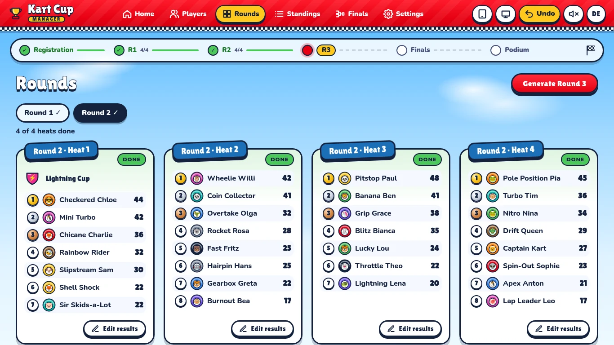
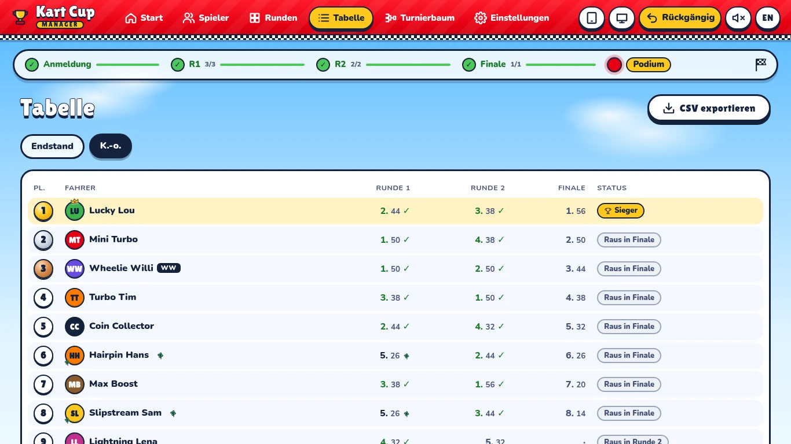
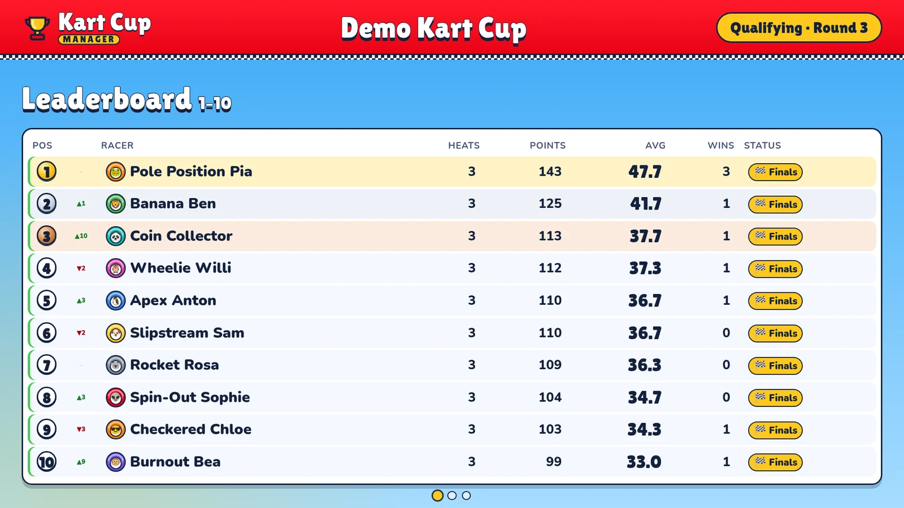

# Kart Cup Manager

A local tournament app for kart-racing nights on **one console**: sign-ups at a kiosk, three formats (knockout cups, a league, or classic qualifying + finals) with a planner that shows how long the night takes, live standings, a TV "big screen" and a podium ceremony with confetti. It runs on one laptop with no backend, no accounts and no internet.


## Screenshots

| | |
|---|---|
|  |  |
| **Kiosk sign-up**: name, gamer tag, badge colour | **Result entry**: tap racers in finishing order, the last one fills in |
|  |  |
| **Round preview** before saving, with repeat-pairing stats | **Rounds**: heat cards with cup, placings and points |
|  |  |
| **Standings**: ▲▼ arrows, finals status, tiebreak tooltip | **Finals setup**: editable stages, seeded qualifiers |
|  |  |
| **Bracket**: semifinals → Grand Final → champion | **Podium ceremony** with confetti |
|  |  |
| **Cup roulette** picks a cup per heat without repeats | **German UI**: one click on EN/DE |

### Big screen (1080p, second window for the TV)

| | |
|---|---|
|  |  |
| **Now racing / Up next** with the picked cup | **Leaderboard** pages rotate automatically |

The screenshots come from a scripted demo run: `npm run build && npm run screenshots`.

## Run it

```bash
npm i && npm run dev
```

Then open the URL Vite prints (usually http://localhost:5173).

## Build the single-file version

```bash
npm run build
```

This produces **`dist/index.html`**: one self-contained file with all JavaScript, CSS and fonts inlined. Copy it to the event laptop (or a USB stick) and double-click it. It works offline, straight from disk. Data is saved in that browser's local storage, so keep using the same browser on the same machine.

## Open it from another device (NordVPN Meshnet, LAN)

```bash
npm run serve
```

This builds and serves the app on port 4173 on all network interfaces. On another Meshnet peer, open `http://<this-device>.nord:4173` (or its Meshnet IP, e.g. `http://100.x.y.z:4173`). Devices on the same Wi-Fi can use the LAN address that Vite prints. The peer needs *Allow incoming traffic* for this device in Meshnet.

**The data stays in the browser that opens the app.** Each device (and even each address: the `.nord` name and the IP count as two) has its own local storage. A phone that opens the app gets its own, separate tournament; it does **not** sync with the laptop, and the big screen only follows windows in the same browser. Use it to run the whole tournament on that device, and move a tournament between devices with *Export backup* / *Import backup*.

## Phone sign-up with a QR code (Kart Cup server)

Guests can sign up on their own phone by scanning a QR code on the TV. That needs the small **Kart Cup
server** on a device on the party network: a Raspberry Pi (`deploy/raspberry-pi/README.md`, with a
full-screen sign-up station on the Pi's own screen as a fallback) or any computer with Node.js 18+:

```bash
npm run package:server
```

```bash
node dist/kart-cup-server/server.mjs
```

Open the address it prints on the organizer's laptop, then *Home → Phone sign-up → Start phone
sign-up*. On a Raspberry Pi the installer sets up a **Kart Cup** Wi-Fi: one QR code on the TV joins
it and the sign-up opens by itself, and the app is reached as `http://kartcup.lan`. The offline
`index.html` keeps working without any of this and never touches the network.

## Tests

```bash
npm test             # unit and property tests (Vitest), report in reports/vitest.json
npm run e2e          # builds, then runs the Playwright specs in e2e/ against dist/index.html
npm run trace:check  # requirements × tests → docs/traceability.md; fails on gaps
```

* **Unit tests** cover the engine (including property tests over randomly played tournaments) and the persistence layer (autosave, full or blocked storage, corrupted data, schema versions, backups, undo, two windows).
* **E2E** (`e2e/*.spec.ts`):
  * `journey-30-max8` plays a 30-player / max-8 tournament from disk: a late sign-up, a kiosk late-joiner, a withdrawal, a reload and a tab close mid-heat, the big screen, finals, podium, exports, German.
  * `journey-11-max4` plays 11 players / max 4 with console totals and a Last Chance heat.
  * `data`, `a11y` and `build` check storage failures, recovery, import/export, keyboard use, reduced motion and that the single file makes no network requests.

  It needs Chromium or Chrome installed (`/usr/bin/chromium` or `CHROMIUM_PATH=…`). Screenshots land in `e2e/out/`.
* **Requirements:** every test names the requirement IDs it covers (`docs/requirements.md`). Visual checks are in `docs/manual-test.md`.

## Project layout

* `src/engine/`: the tournament rules as pure TypeScript functions (no React), with unit tests next to them.
* `src/data/cups.ts`: cup and track names. **Correct the names here** if needed.
* `src/i18n.ts`: every UI string, English and German.
* `DECISIONS.md`: every assumption and why.

---

## Organizer cheat sheet (event day)

**Before guests arrive**
1. Open the app (from the Kart Cup server: `http://kartcup.lan`; or the offline `index.html`). **New tournament** → give it a name → sign-up is open.
2. Sign-up: guests scan the QR code on the TV (Kart Cup server), use the kiosk window or the station on the Pi's screen, or you add them (*Players → Add* or *Quick add*).
3. Plug in the TV. Press the **TV icon** in the top bar, drag the new window to the TV and **double-click it for fullscreen**. It updates by itself and has no buttons.
4. Press **Export backup** once so you have a starting point.

**Start racing**
* When everyone is there: Home → **Start racing**. Choose the heat size (how many play at once tonight), check the suggested format (league if everyone fits into one heat, otherwise knockout cups; classic is there too), how round 1 is raced (**Grand Prix** or **VS races**, and the class), and whether **late sign-ups** are allowed. The plan on the right shows every round, the time and, with a start time (Settings), when the night ends.

**Check-in**
* Kiosk sign-ups are checked in automatically. Quick-add guests: tick **Checked in** in *Players* when they arrive.
* Only checked-in players are put into heats.

**Each round**
1. Home → **Generate Round N** / **Start cup N** → choose Grand Prix or VS races for this round → look at the preview → *Redraw* if you like (classic rounds) → **Save round**. Later knockout rounds are seeded from the results, so there is nothing to redraw. A tie on a knockout cut line asks for a sudden death first.
2. The Home screen shows **Now racing** in big letters. Press **Spin the cup** (if you use the cup picker); the TV shows the roulette too.
3. After the heat: **Enter results**.
   * *Tap mode:* tap the racers in finishing order after every race (or press 1–8). The last one fills in by itself, and the next race opens automatically.
   * *Console totals* (default): type the cup points from the console. With equal points, use the arrows to set who was ahead.
   * *Final order only:* tap the final cup order once.
4. **Save heat**. The next heat moves to "Now racing". Repeat until the round is complete.
* Wrong result? Open the heat again (**Edit results**); all standings recompute.
* Need a different heat order? Use the ▲▼ buttons on unplayed heat cards. To move a single racer, use the ✥ button next to their name.

**Late arrivals & drop-outs**
* Late arrival: add them (kiosk or *Players → Add players*). Classic and league: they race from the next round/cup. Knockout: only while a round-1 heat still has a free seat. If a heat has a free slot, the app offers to put them in right away.
* Home shows the time per heat measured so far, the heats left and the expected end.
* Someone has to leave: *Players → Withdraw*. They leave future heats, their results stay.

**Finals (classic)**
1. After the last qualifying round: Home → **Set up the finals**. The bracket is chosen automatically (you can edit it).
2. If two players are tied exactly on the cut line, the app asks for a **sudden death**: race one race, tap the finishing order, save.
3. **Start finals** → play the heats from Home as before. The bracket fills itself.
4. After the Grand Final: **Start the podium ceremony** 🎉. The TV switches to the podium too.

**Safety net**
* Everything is saved automatically after every click. Reloading or even closing the browser loses nothing.
* **Undo** (top bar) reverts the last 30 actions.
* Export a backup now and then (*Settings → Export backup*). The browser warns you before closing if you haven't.
* *Settings → Export standings (CSV)* gives you a spreadsheet of the results.
* Sound is off by default (speaker icon in the top bar). EN/DE switches the language.

## Licence and trademarks

The code is under the [MIT licence](LICENSE). The bundled fonts (Lilita One, Nunito) are under the SIL Open Font License, see their packages in `node_modules/@fontsource/`.

Kart Cup Manager is a fan-made organizer tool. It is **not affiliated with, endorsed or sponsored by Nintendo**. Mario Kart, Nintendo Switch and the cup and track names are trademarks of Nintendo; they appear only as plain text so the organizer can pick what to race. The app contains no Nintendo artwork, logos, sprites, fonts or sounds: every icon and graphic is drawn for this project.
