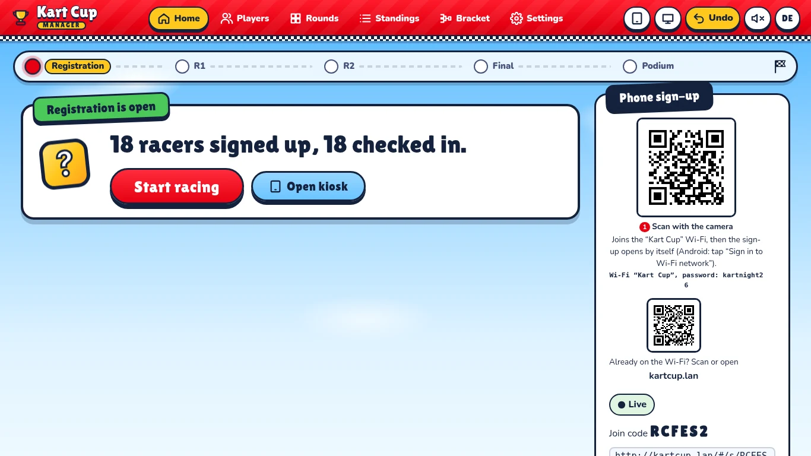
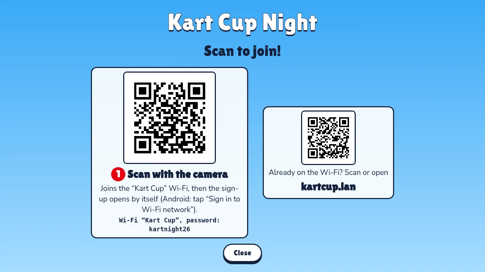
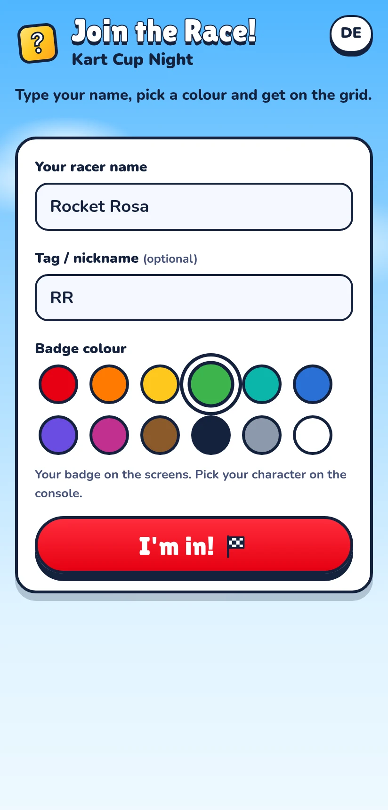
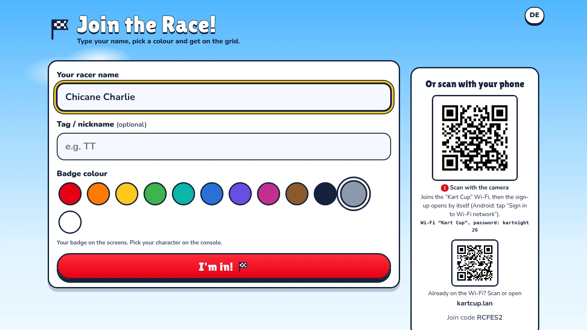
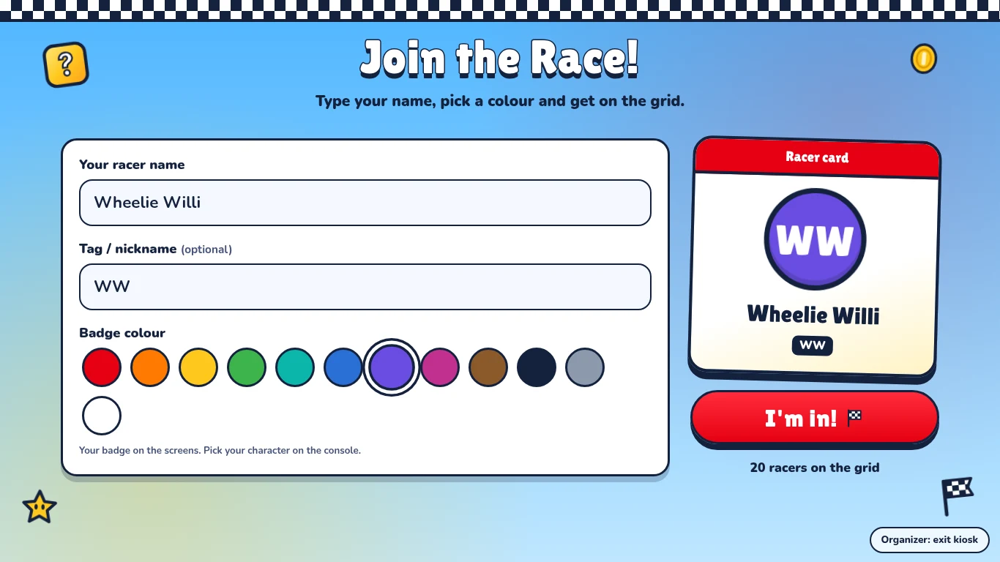
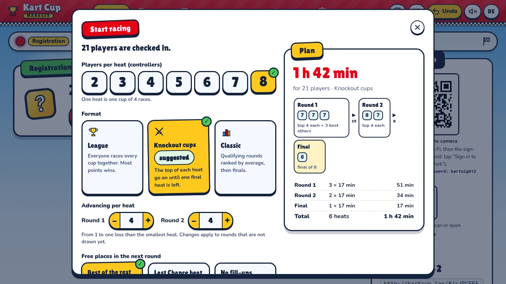
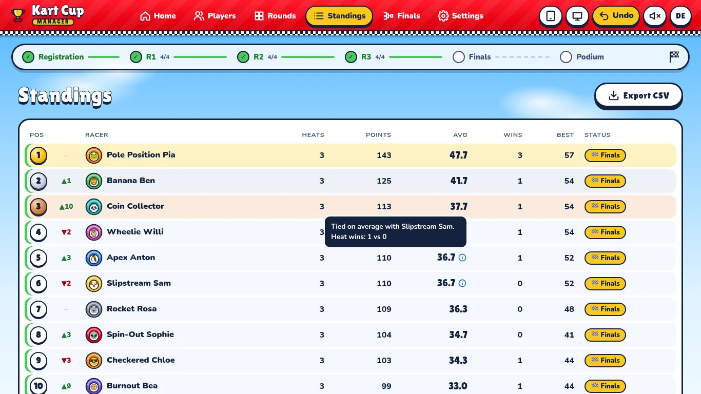
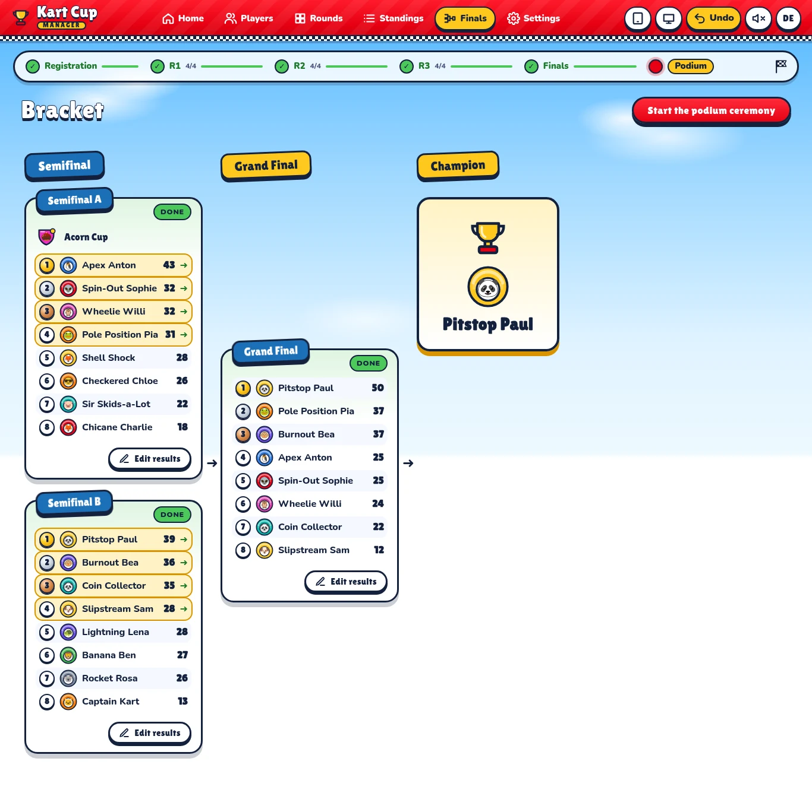
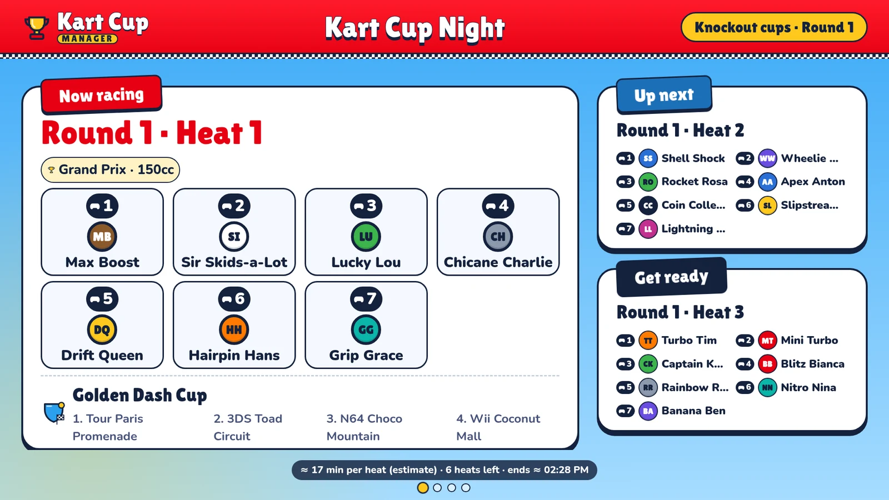
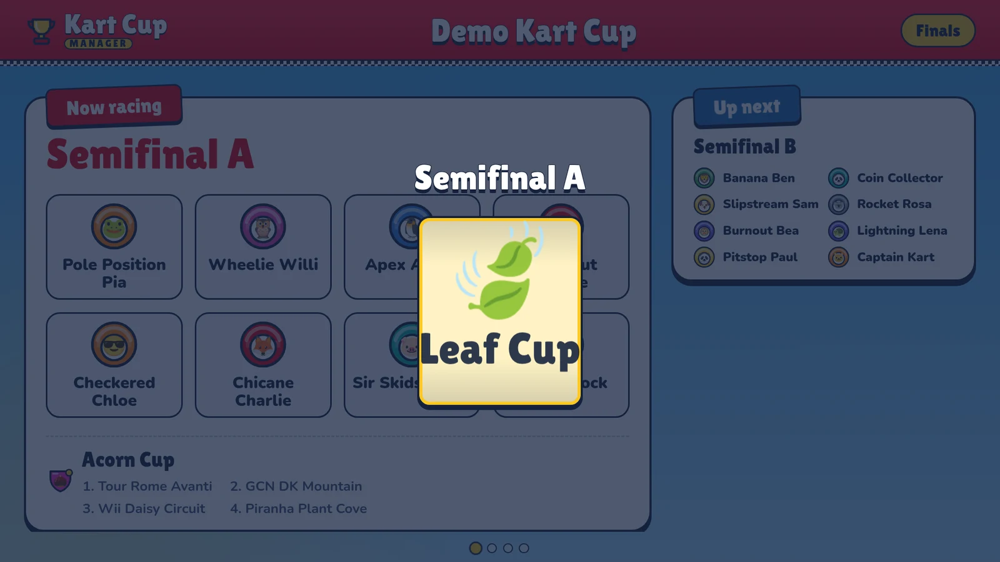

# Kart Cup Manager

A tournament app for kart-racing nights on **one console** (made for Mario Kart 8 Deluxe on the Switch 2, up to 8 players at once). Guests sign up first (on their phone by QR code, at a kiosk or at the Raspberry Pi's screen), then the app draws the heats, tells everyone which **controller** to take, plans how long the night takes, keeps the standings live, puts it all on the TV and ends with a podium ceremony. No accounts, no cloud, no internet: the offline version is a single HTML file, and phone sign-up runs on a small server in the room (a Raspberry Pi with its own "Kart Cup" Wi-Fi, or any laptop).


**What it does**

* **Sign-up first:** phones scan one QR code that joins the Pi's Wi-Fi and opens the sign-up page by itself; a kiosk window and a sign-up station on the Pi's screen work too. Late sign-ups can stay open after the start.
* **Three formats:** **knockout cups** (the top of each heat go on; free places are filled with the best of the rest or a Last Chance heat), a **league** (everyone races every cup), or **classic** qualifying rounds with finals. The app suggests one from the number of players.
* **A planner** shows every round, the number of heats and the time, warns when the night runs long and offers shorter variants.
* **Mario Kart terms:** each round is a **Grand Prix** (a cup of 4 races) or **VS races**, at 50/100/150/200cc or Mirror. Results are typed from the console's totals, tapped race by race, or entered as the final order.
* **Controller numbers** 1–8 per heat, colour badges with initials, cup roulette, measured time per heat and the expected end, **TV mode**, podium with confetti, English and German, undo, backups and CSV export.

## Screenshots

### Sign-up

| | |
|---|---|
|  |  |
| **Home during sign-up**: Start racing, the kiosk and the phone sign-up card | **Show QR code**: Wi-Fi + sign-up in one code, full screen on the Pi's screen |
|  |  |
| **On the phone**: name, tag, badge colour | **Station** on the Pi's screen with keyboard and mouse |
|  | |
| **Kiosk** window for a tablet or laptop | |

### Racing

| | |
|---|---|
|  |  |
| **Start racing**: controllers, suggested format, the plan and its time | **Round preview**: heats with controller numbers, race mode, redraw |
|  |  |
| **Cup roulette** picks a cup per heat without repeats | **Result entry**: the cup totals from the console, live placing |
|  |  |
| **Rounds**: seeded round 2, lucky losers wear the clover | **Standings**: every round per racer, champion's crown |
|  |  |
| **Bracket**: rounds → final → champion | **Podium ceremony** with confetti |
|  | |
| **German UI**: one click on EN/DE | |

### TV (1080p, its own window)

| | |
|---|---|
|  |  |
| **Now racing / Up next / Get ready** with controller numbers | **Cup roulette** on the TV |
|  | |
| **Leaderboard** pages rotate between heats | |

The screenshots come from a scripted run with invented names: `npm run build && npm run screenshots` (it starts the Kart Cup server with throwaway data).

## Three ways to run it

| | What you get | How |
|---|---|---|
| **Offline file** | Everything except phone sign-up. One laptop, no network. | `npm run build`, then open `dist/index.html` |
| **Kart Cup server** on a laptop | Plus phone sign-up over the party network | `npm run host` (or `npm run package:server` and `node server.mjs` on any device with Node.js 18+) |
| **Raspberry Pi** | Plus its own "Kart Cup" Wi-Fi with one QR code, the name `kartcup.lan`, the admin screen at boot and a sign-up station | [deploy/raspberry-pi/README.md](deploy/raspberry-pi/README.md) |

### Develop

```bash
npm i && npm run dev
```

Then open the URL Vite prints (usually http://localhost:5173). The dev server has no phone sign-up; use `npm run host` for that.

### The single-file version

```bash
npm run build
```

This produces **`dist/index.html`**: one self-contained file with all JavaScript, CSS and fonts inlined. Copy it to the event laptop (or a USB stick) and double-click it. It works offline, straight from disk, and never touches the network. Data is saved in that browser's local storage, so keep using the same browser on the same machine.

### Phone sign-up with a QR code (Kart Cup server)

Guests sign up on their own phone by scanning a QR code on the TV or the organizer's screen. That needs the small **Kart Cup server** (`src/server/`, one file without dependencies) on a device in the room:

```bash
npm run package:server
```

```bash
node dist/kart-cup-server/server.mjs
```

Open the address it prints on the organizer's laptop, then *Home → Start phone sign-up*. Sign-ups arrive in the organizer's window within seconds. The server keeps only sign-up sessions (join code plus a hashed admin key); the tournament itself stays in the organizer's browser. On a Raspberry Pi the installer adds the **Kart Cup** Wi-Fi: one QR code joins it and the sign-up opens by itself, and the app is reached as `http://kartcup.lan`.

### Open it from another device (NordVPN Meshnet, LAN)

```bash
npm run serve
```

This builds and serves the app on port 4173 on all network interfaces. On another Meshnet peer, open `http://<this-device>.nord:4173` (or its Meshnet IP, e.g. `http://100.x.y.z:4173`). Devices on the same Wi-Fi can use the LAN address that Vite prints. The peer needs *Allow incoming traffic* for this device in Meshnet.

**The data stays in the browser that opens the app.** Each device (and even each address: the `.nord` name and the IP count as two) has its own local storage. A second device gets its own, separate tournament; it does **not** sync, and the TV window only follows windows in the same browser. Move a tournament between devices with *Export backup* / *Import backup*.

## Tests

```bash
npm test             # unit and property tests (Vitest), report in reports/vitest.json
npm run e2e          # builds, then runs the Playwright specs in e2e/
npm run trace:check  # requirements × tests → docs/traceability.md; fails on gaps
```

* **Unit tests** cover the engine (formats, knockout and fill-ups, planner, timing, controller numbers, with property tests over randomly played tournaments), the persistence layer (autosave, full or blocked storage, corrupted data, schema migrations, backups, undo, two windows), the QR encoder, the Kart Cup server (sessions, hostile input, rate limits, captive redirect) and the translations.
* **E2E** (`e2e/*.spec.ts`, Chromium):
  * `journey-30-max8` plays a 30-player / max-8 night from disk: late sign-ups, a withdrawal, a reload and a tab close mid-heat, the TV, finals, podium, exports, German.
  * `journey-11-max4` plays 11 players / max 4 with console totals and a Last Chance heat.
  * `journey-formats` covers the planner, a knockout night with lucky losers, Last Chance, a league and the measured time.
  * `phone` runs the real Kart Cup server: QR codes, a phone sign-up, the station, the TV and closing registration.
  * `data`, `a11y` and `build` check storage failures, recovery, import/export, keyboard use, reduced motion and that the single file makes no network requests.

  It needs Chromium or Chrome installed (`/usr/bin/chromium` or `CHROMIUM_PATH=…`). Screenshots land in `e2e/out/`.
* **Requirements:** every test names the requirement IDs it covers (`docs/requirements.md`). Checks that need real devices (a phone camera, the Pi) are in `docs/manual-test.md`.

## Project layout

* `src/engine/`: the tournament rules as pure TypeScript functions (no React), with unit tests next to them.
* `src/screens/`, `src/components/`: the React screens; `src/components/Glyphs.tsx` draws every icon as SVG (no emoji, so nothing depends on the fonts of the device).
* `src/server/`: the Kart Cup server (Node.js, no dependencies); `src/lib/server.ts` is the app's side of it.
* `deploy/raspberry-pi/`: installer, Wi-Fi (hostapd + dnsmasq) and services for the Pi.
* `src/data/cups.ts`: cup and track names. **Correct the names here** if needed.
* `src/i18n.ts`: every UI string, English and German.
* `DECISIONS.md`: every assumption and why. `docs/spec.md` is the original brief, `docs/plan-v2.md` the plan for version 2.

---

## Organizer cheat sheet (event day)

**Before guests arrive**
1. Open the app: on the Pi it is already open full screen after boot; otherwise `http://kartcup.lan` (Kart Cup server) or the offline `index.html`. **New tournament** → give it a name → sign-up is open.
2. Sign-up: with the Kart Cup server press **Start phone sign-up** on Home and **Show QR code**; guests scan it with the phone camera. Without a server: the **kiosk** window (tablet icon). You can always add people yourself (*Players → Add* or *Quick add*).
3. Plug in the TV. Press the **TV icon** in the top bar, drag the new window to the TV and **double-click it for fullscreen**. It updates by itself and has no buttons.
4. Press **Export backup** once so you have a starting point.

**Start racing**
* When everyone is there: Home → **Start racing**. Choose the heat size (how many play at once tonight), check the suggested format (league if everyone fits into one heat, otherwise knockout cups; classic is there too), how round 1 is raced (**Grand Prix** or **VS races**, and the class), and whether **late sign-ups** are allowed. The plan on the right shows every round, the time and, with a start time (Settings), when the night ends.

**Check-in**
* Kiosk sign-ups are checked in automatically. Quick-add guests: tick **Checked in** in *Players* when they arrive.
* Only checked-in players are put into heats.

**Each round**
1. Home → **Generate Round N** / **Start cup N** → choose Grand Prix or VS races for this round → look at the preview → *Redraw* if you like (classic rounds) → **Save round**. Later knockout rounds are seeded from the results, so there is nothing to redraw. A tie on a knockout cut line asks for a sudden death first.
2. The Home screen shows **Now racing** in big letters, each racer with their **controller number** (1–8): hand out the controllers by these numbers. Press **Spin the cup** (if you use the cup picker); the TV shows the roulette too.
3. After the heat: **Enter results**.
   * *Tap finishing order:* tap the racers in finishing order after every race (or press their controller numbers). The last one fills in by itself, and the next race opens automatically.
   * *Console totals* (default): type the cup points from the console. With equal points, use the arrows to set who was ahead.
   * *Final order only:* tap the final cup order once.
4. **Save heat**. The next heat moves to "Now racing". Repeat until the round is complete.
* After the last heat (the knockout final, the last league cup) Home offers **Start the podium ceremony**; the TV switches to the podium too.
* Wrong result? Open the heat again (**Edit results**); all standings recompute.
* Need a different heat order? Use the ▲▼ buttons on unplayed heat cards. To move a single racer, use the move button (four arrows) next to their name.

**Late arrivals & drop-outs**
* Late arrival: add them (kiosk or *Players → Add players*). Classic and league: they race from the next round/cup. Knockout: only while a round-1 heat still has a free seat. If a heat has a free slot, the app offers to put them in right away.
* Home shows the time per heat measured so far, the heats left and the expected end.
* Someone has to leave: *Players → Withdraw*. They leave future heats, their results stay.

**Finals (classic format only)**
1. After the last qualifying round: Home → **Set up the finals**. The bracket is chosen automatically (you can edit it).
2. If two players are tied exactly on the cut line, the app asks for a **sudden death**: race one race, tap the finishing order, save.
3. **Start finals** → play the heats from Home as before. The bracket fills itself.
4. After the Grand Final: **Start the podium ceremony**. The TV switches to the podium too.

**Safety net**
* Everything is saved automatically after every click. Reloading or even closing the browser loses nothing.
* **Undo** (top bar) reverts the last 30 actions.
* Export a backup now and then (*Settings → Export backup*). The browser warns you before closing if you haven't.
* *Settings → Export standings (CSV)* gives you a spreadsheet of the results.
* Sound is off by default (speaker icon in the top bar). EN/DE switches the language.

## Licence and trademarks

The code is under the [MIT licence](LICENSE). The bundled fonts (Lilita One, Nunito) are under the SIL Open Font License, see their packages in `node_modules/@fontsource/`.

Kart Cup Manager is a fan-made organizer tool. It is **not affiliated with, endorsed or sponsored by Nintendo**. Mario Kart, Nintendo Switch and the cup and track names are trademarks of Nintendo; they appear only as plain text so the organizer can pick what to race. The app contains no Nintendo artwork, logos, sprites, fonts or sounds: every icon and graphic is drawn for this project.
