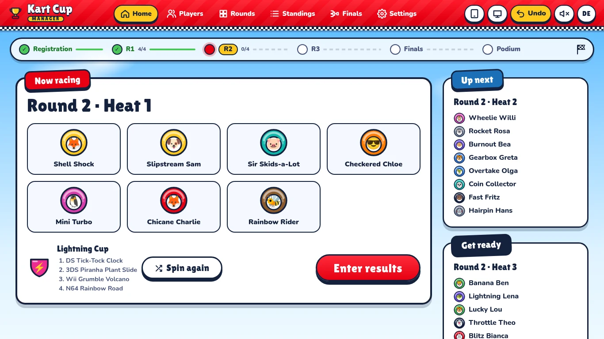
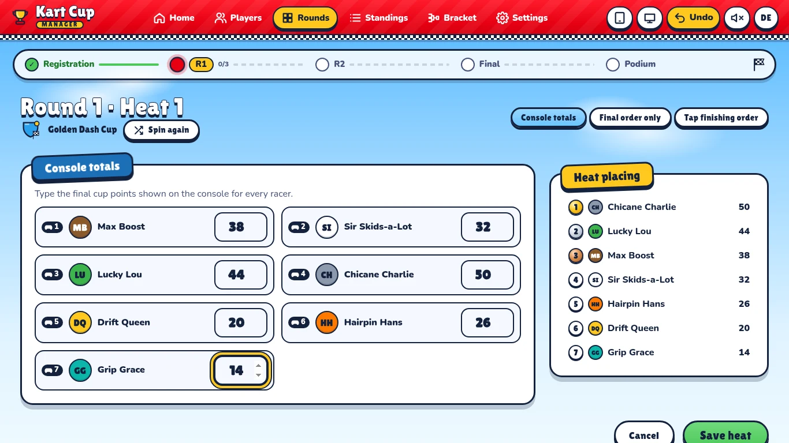
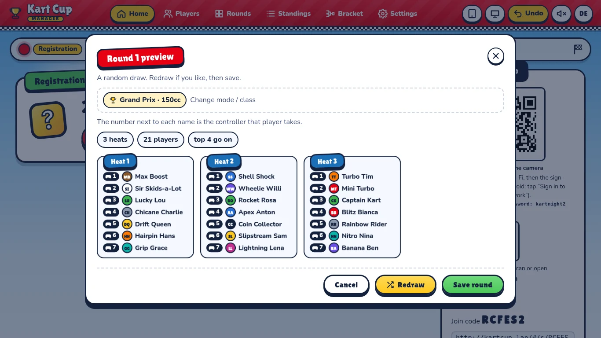
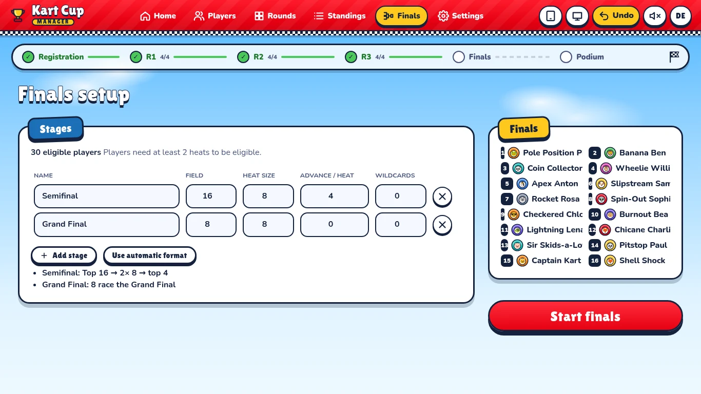
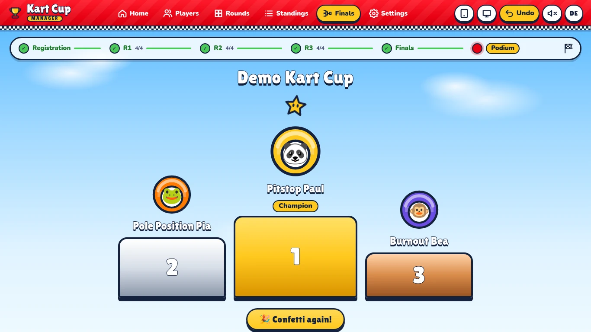
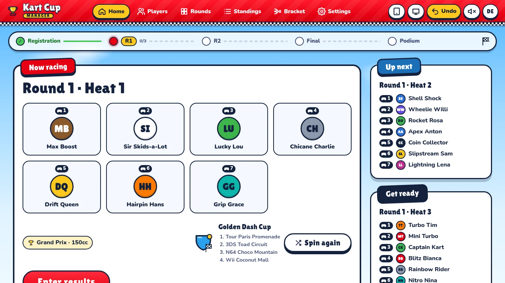

# Kart Cup Manager

A local tournament app for kart-racing nights on **one console**: sign-ups at a kiosk, balanced qualifying heats, live standings, a seeded finals bracket, a TV "big screen" and a podium ceremony with confetti. It runs on one laptop with no backend, no accounts and no internet.



## Screenshots

| | |
|---|---|
|  |  |
| **Kiosk sign-up** on a tablet: name, driver, color, racer card | **Result entry**: tap racers in finishing order, the last one fills in |
|  |  |
| **Round preview** before saving, with repeat-pairing stats | **Rounds**: heat cards with cup, placings and points |
|  |  |
| **Standings**: ▲▼ arrows, finals status, tiebreak tooltip | **Finals setup**: editable stages, seeded qualifiers |
|  |  |
| **Bracket**: semifinals → Grand Final → champion | **Podium ceremony** with confetti |
|  |  |
| **Cup roulette** picks a cup per heat without repeats | **German UI**: one click on EN/DE |

### Big screen (1080p, second window for the TV)

| | |
|---|---|
|  |  |
| **Now racing / Up next** with the picked cup | **Leaderboard** pages rotate automatically |

The screenshots come from a scripted demo run: `npm run build && npm run screenshots`.

## Run it

```bash
npm i && npm run dev
```

Then open the URL Vite prints (usually http://localhost:5173).

## Build the single-file version

```bash
npm run build
```

This produces **`dist/index.html`**: one self-contained file with all JavaScript, CSS and fonts inlined. Copy it to the event laptop (or a USB stick) and double-click it. It works offline, straight from disk. Data is saved in that browser's local storage, so keep using the same browser on the same machine.

## Tests

```bash
npm test          # engine unit tests (Vitest)
npm run build && npm run e2e   # full click-through tournaments, screenshots in e2e/out/
```

The E2E run plays a 30-player / max-8 tournament (with a late sign-up, a kiosk late-joiner, a withdrawal and a reload mid-heat), then an 11-player / max-4 tournament with console totals and a Last Chance heat. It needs Chromium or Chrome installed (`/usr/bin/chromium` or `CHROMIUM_PATH=…`).

## Project layout

* `src/engine/`: the tournament rules as pure TypeScript functions (no React), with unit tests next to them.
* `src/data/cups.ts`: cup and track names. **Correct the names here** if needed.
* `src/i18n.ts`: every UI string, English and German.
* `DECISIONS.md`: every assumption and why.

---

## Organizer cheat sheet (event day)

**Before guests arrive**
1. Open `index.html` on the laptop. Choose **New tournament** and walk through the 5 setup steps. The time estimate on the right updates as you go.
2. Already have a guest list? **Players → Quick add**, paste the names (one per line).
3. Plug in the TV. Press the **TV icon** in the top bar, drag the new window to the TV and **double-click it for fullscreen**. It updates by itself and has no buttons.
4. Optional: open the **Kiosk** (tablet icon) on a second screen or tablet so people can sign up themselves ("Join the Race!").
5. Press **Export backup** once so you have a starting point.

**Check-in**
* Kiosk sign-ups are checked in automatically. Quick-add guests: tick **Checked in** in *Players* when they arrive.
* Only checked-in players are put into heats.

**Each round**
1. Home → **Generate Round N** → look at the preview → *Regenerate* if you don't like it → **Save round**.
2. The Home screen shows **Now racing** in big letters. Press **Spin the cup** (if you use the cup picker); the TV shows the roulette too.
3. After the heat: **Enter results**.
   * *Tap mode:* tap the racers in finishing order after every race (or press 1–8). The last one fills in by itself, and the next race opens automatically.
   * *Console totals:* type the cup points from the console. With equal points, use the arrows to set who was ahead.
4. **Save heat**. The next heat moves to "Now racing". Repeat until the round is complete.
* Wrong result? Open the heat again (**Edit results**); all standings recompute.
* Need a different heat order? Use the ▲▼ buttons on unplayed heat cards. To move a single racer, use the ✥ button next to their name.

**Late arrivals & drop-outs**
* Late arrival: add them (kiosk or *Players → Add players*). They race from the next round. If a heat in the current round still has a free slot, the app offers to put them in right away.
* Someone has to leave: *Players → Withdraw*. They leave future heats, their results stay.

**Finals**
1. After the last qualifying round: Home → **Set up the finals**. The bracket is chosen automatically (you can edit it).
2. If two players are tied exactly on the cut line, the app asks for a **sudden death**: race one race, tap the finishing order, save.
3. **Start finals** → play the heats from Home as before. The bracket fills itself.
4. After the Grand Final: **Start the podium ceremony** 🎉. The TV switches to the podium too.

**Safety net**
* Everything is saved automatically after every click. Reloading or even closing the browser loses nothing.
* **Undo** (top bar) reverts the last 30 actions.
* Export a backup now and then (*Settings → Export backup*). The browser warns you before closing if you haven't.
* *Settings → Export standings (CSV)* gives you a spreadsheet of the results.
* Sound is off by default (speaker icon in the top bar). EN/DE switches the language.
